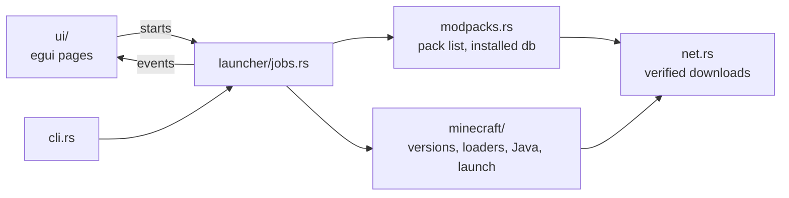

# Akulav Launcher: architecture

How the launcher is put together. What it does for players is in the [README](../README.md).

## Overview

One Rust program with an [egui](https://github.com/emilk/egui) window and a `--cli` mode. The UI thread only
draws; everything slow (pack lists, downloads, installs, launching Java) runs as background jobs that report back
through events.

## Modules

### `launcher/`: everything that isn't drawing

| File | Role |
|---|---|
| `jobs.rs` | Long-running work: loading the pack list, preparing and launching a pack, repairing it |
| `events.rs` | The messages jobs send to the UI (progress, log lines, results) |
| `modpacks.rs` | The remote modpack list, the local "installed" database, pack installation |
| `net.rs` | One shared HTTP client, downloads verified against their hashes, parallel batches |
| `paths.rs` | The folder layout: everything under the install folder the user chose |
| `settings.rs` | Launcher settings: player name, RAM, JVM arguments, resolution, what happens after launch, a custom pack list or Java |
| `skins.rs` | Skin lookup for the avatar: the Mojang profile, then Ely.by, cached for a few hours |
| `system.rs` | Memory size, opening folders, the click sound |
| `update.rs` | Update check against GitHub releases (one file per OS plus `SHA256SUMS.txt`) |
| `install/` | Installing, updating and removing the launcher itself: Inno Setup on Windows, self-install on Linux / macOS |

### `launcher/minecraft/`: running the game

| File | Role |
|---|---|
| `version.rs` | Mojang's version JSON model, rule evaluation (OS, features) and `inheritsFrom` merging |
| `install.rs` | Downloads and verifies version JSONs, libraries, the client jar, assets and natives |
| `loader.rs` | Detects and installs the pack's mod loader: NeoForge, Forge, Fabric or Quilt |
| `java.rs` | Downloads the exact Java runtime Mojang ships for that Minecraft version |
| `launch.rs` | Builds the Java command line; offline UUIDs follow `nameUUIDFromBytes("OfflinePlayer:" + name)` |

### `ui/`: the window

| File | Role |
|---|---|
| `app.rs` | App state, event handling, title bar, sidebar, toasts and dialogs |
| `home.rs` | The Play page: the selected pack, the library strip, the play bar, pack settings |
| `settings_page.rs` | Global settings |
| `console.rs` | The live log of the launcher, installers and the game |
| `head.rs` | A shaded 3D Minecraft head from a 64×64 skin (or a generated one) |
| `backdrop.rs` | The animated wallpaper: a pure function of time, so it costs nothing when idle |
| `theme.rs`, `widgets.rs` | Colours, fonts and custom-drawn widgets shared with Akulav's other apps |

## Launching a pack

1. **Pack**: `modpacks.rs` installs or updates the pack's files into its instance folder.
2. **Version**: `version.rs` loads the Minecraft version and the loader's version that inherits from it, and
   merges them.
3. **Files**: `install.rs` fetches every missing or damaged library, asset and native library; each download is
   checked against its hash, so a repair is just "prepare again".
4. **Java**: `java.rs` makes sure the matching Java runtime is present.
5. **Launch**: `launch.rs` builds the command line with the player's name, RAM and paths, and the console
   streams the game's output.

`AkulavLauncher --cli launch "<pack>" [--prepare-only] [--repair]` runs the same steps without the window.

## Where data lives

Everything (the program, settings, packs, Minecraft files, Java runtimes, logs, caches) lives in the one install
folder the user picked. Nothing is written to the user profile. See [`launcher/paths.rs`](../src/launcher/paths.rs)
for the exact layout.

## Releases

A release carries exactly one file per OS plus `SHA256SUMS.txt`: `AkulavLauncher-setup.exe` (Windows, Inno Setup
`installer/akulav-launcher.iss`) and a self-installing program for Linux x64 and macOS (Apple Silicon). The same
file installs and updates. Installed copies check GitHub, verify the download against the checksums and apply it.
